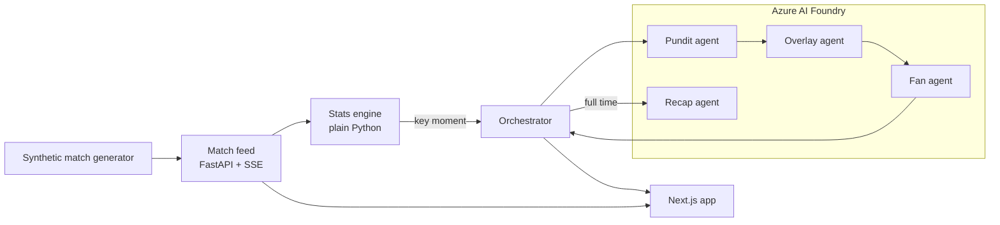

# AgPitch

Live football match insights that explain *why* the game is changing, written for every kind of fan.

Built for the **Inside the Game: Developer Hackathon** (Microsoft + Premier League), challenge: *The Synthetic Match Insights Engine for Premier League Studio*.

> Demo video: _(link coming)_

> Live app: https://thankful-rock-0c1b05c0f.6.azurestaticapps.net

## Why I built this

When you watch a match you get the score and a few stats, but nobody tells you why the game just turned. Why did a team suddenly start losing the ball? Was that save actually important? I wanted something that sits next to the match and explains it, and that talks differently to a stats nerd and to someone who just supports the team.

AgPitch replays a synthetic match live, flags the moments that matter, and has a small team of AI agents on **Azure AI Foundry** explain each one, turn it into an on-screen graphic, and rewrite it for the person watching, in English, Spanish or Portuguese.

## What it does

- **Live replay** of a full 90-minute synthetic match (Kryptonites vs Ultras), streamed to the browser as it happens
- **Stats engine** in plain Python: possession (overall and last 10 minutes), pass accuracy, pass distance, a 0-10 pass difficulty rating, passes under pressure, shot speed, saves, corners, counter-attacks, cards
- **Key moments** flagged by simple rules: turnover streaks, pressure spikes, momentum swings, big saves, counter-attacks, cards, speed alerts, goals
- **AI insight cards** for every key moment, appearing at the exact minute it happens, with a "Why it matters" explanation
- **Personalisation:** casual fan, analyst or player-focus mode, favourite club, favourite player, and language (EN / ES / PT)
- **Live commentary** feed: shots, saves, blocks, corners, counter-attacks, fouls, cards, injuries
- **Stats tab** with top stats and a clickable shot map
- **Full-time recap** written for the viewer by the Recap agent

## How it works



The five stages from the brief map onto the code like this:

| Stage | Where |
|---|---|
| Ingest | `backend/app/main.py` replays the match event by event and streams it with Server-Sent Events |
| Interpret | `backend/app/stats.py` computes the numbers and flags key moments, no AI |
| Explain | **Pundit** agent: why the moment matters (control vs chaos, pressure, momentum, rhythm) |
| Render | **Overlay** agent: a timed, machine-readable graphic (type, headline, stat, duration, priority) |
| Personalise | **Fan** agent: rewrites it for the viewer's mode, club, player and language. **Recap** agent at full time |

A few decisions I made on purpose:

- **The stats are not done by the AI.** LLMs are bad at counting, so all numbers come from the stats engine and the agents are told to only use numbers from the input.
- **Only key moments go to the agents**, about 46 per match, not all ~1,400 events. Faster and cheaper.
- **Pundit and Overlay run once per moment and are shared by everyone. Fan runs once per viewer profile.** Ten viewers with the same profile cost one call.
- **The stream never waits for the AI.** Each moment is a background task. The card appears instantly with an "Analysing" state and fills in when the agents answer (about 10-20 seconds).
- **Everything is cached**, in memory and on disk. A `/warmup` endpoint runs a whole match through the agents in parallel before a broadcast, so every insight is ready on time. I use this for the demo.
- **If Azure fails**, the viewer still gets a basic card from the stats engine, so the stream never breaks.
- **Every agent takes JSON in and gives JSON out**, so the frontend never has to guess.

## Synthetic data

No real Premier League data is used. `backend/app/generator.py` builds a full match from a scripted storyline: Kryptonites control the first half and score, Ultras switch to a high press after the break, take over, equalise and win it late. Around that, it generates passes, shots, saves, corners, counter-attacks, fouls, cards and injuries, with pitch coordinates for every action. A fixed random seed means it's the same match every run.

All teams and players are made up.

## Tech

- **Azure AI Foundry Agent Service** with `gpt-5-mini`: four agents (Pundit, Overlay, Fan, Recap), created from code (`python -m backend.app.agents setup`) so their instructions are versioned in this repo
- **Python 3.13, FastAPI, Server-Sent Events** for the backend
- **Next.js 16 + React 19** for the frontend, plain CSS
- `azure-ai-projects` and `azure-identity`: login uses `az login`, no API keys in the code

## Deployment

- **Backend:** Azure Container Apps (Sweden Central), one always-on replica so there's no cold start
- **Frontend:** Azure Static Web Apps, built as a static export with the API address baked in
- **Container image:** built by GitHub Actions on every push and stored in GitHub Container Registry (my free-trial subscription doesn't allow building images inside Azure, so I moved the build to GitHub)
- **Access to the agents:** the backend uses a managed identity with the Cognitive Services User role on the Foundry resource. No API keys anywhere
- **CORS:** the API only accepts requests from localhost and the deployed frontend

## Run it locally

You need Python 3.13, Node 20+, the Azure CLI and an Azure AI Foundry project with a `gpt-5-mini` deployment.

```bash
# backend
python3.13 -m venv .venv
source .venv/bin/activate
pip install -r backend/requirements.txt
az login
```

Create a `.env` in the project root:

```
PROJECT_ENDPOINT=<your Foundry project endpoint>
MODEL_DEPLOYMENT=gpt-5-mini
```

```bash
python -m backend.app.agents setup              # create the 4 agents in Foundry
python -m uvicorn backend.app.main:app --reload # API on http://localhost:8000
```

```bash
# frontend (second terminal)
cd frontend
npm install
npm run dev                                     # app on http://localhost:3000
```

Optional, before a demo, prepare every insight for a viewer profile:

```bash
curl "http://localhost:8000/warmup?mode=casual&club=Ultras&language=en"
```

The repo already includes the cache from my runs (`backend/data/cache/`), so the demo match shows full insights for the prepared profiles even without Azure access.

Other useful commands:

```bash
python backend/app/generator.py          # rebuild the match
python backend/app/stats.py              # replay it and print every key moment
python -m backend.app.agents test        # send one real moment through the agents
```

## Project structure

```
backend/
  app/
    generator.py      synthetic match generator
    stats.py          stats engine + key moment rules
    agents.py         the 4 Foundry agents and their instructions
    orchestrator.py   runs the agents in the background, caching, warm-up
    main.py           FastAPI: /match, /stream (SSE), /warmup, /cache/clear
  data/
    match_001.json    the demo match
    cache/            prepared agent answers
frontend/
  app/                page, layout, styles
  components/         header, live tab, stats tab, recap, settings
  lib/                SSE hook, team colours, translations
```

## What I'd do next

- Auto-eventing: generating these events from video instead of synthetic data
- More languages, and checking each one with native speakers. I tried Telugu (my own language) first and the output wasn't good enough, so I left it out rather than ship something I wouldn't watch myself
- A momentum chart across the whole match

---

Built by Roshan Palem. MIT licence.
